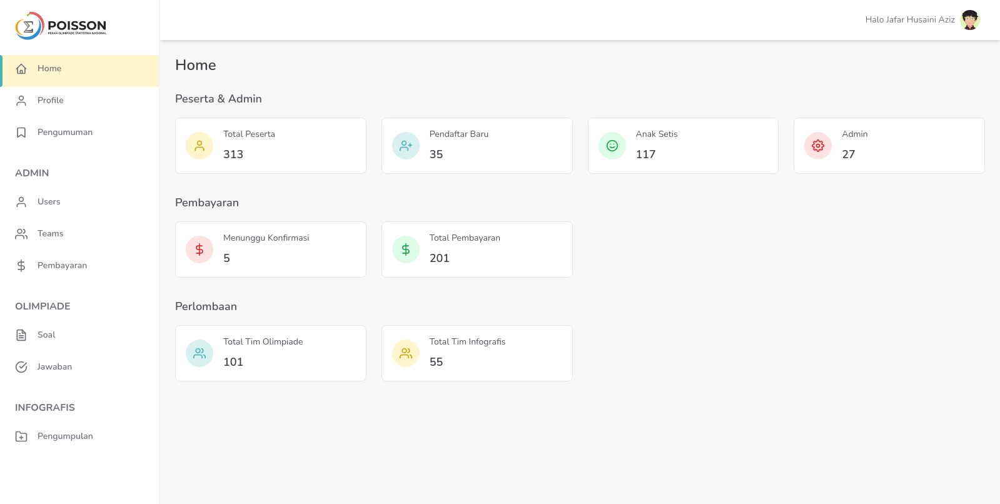

<!-- TOC -->

- [Overview](#overview)
  - [What we use](#what-we-use)
- [Development and Production](#development-and-production)
  - [Development](#development)
  - [Development with docker](#development-with-docker)
  - [Deployment](#deployment)
- [Concept](#concept)
- [Implementation](#implementation)
  - [Views](#views)
  - [Middleware](#middleware)
  - [Model, Role, and Permission](#model-role-and-permission)
  - [Controller](#controller)
  - [Landing Page](#landing-page)

<!-- /TOC -->

# Overview

All in one for poisson competition created with Laravel & Livewire, Here what you can do

- user and team registration
- user and team management
- user and team confirmation
- payment management
- download and upload for _infografis_ and _olimpiade_ (big file up to 100mb)
- monitoring.

## What we use

Library and Framework that we use for build this project

| Frameork / library                  | Description                                                                                    |
| ----------------------------------- | ---------------------------------------------------------------------------------------------- |
| `Laravel 8`                         | PHP Fullstack framework                                                                        |
| `Livewire 2.0`                      | Fullstack framework for Laravel that makes building dynamic interfaces simple                  |
| `Jetsream`                          | Application starter kit for laravel that provides login, registration, session management, etc |
| `Spatie/laravel-permission`         | Laravel library for manage user permissions and roles in a database                            |
| `rappasoft/laravel-livewire-tables` | A dynamic Laravel Livewire component for data tables.                                          |
| `Tailwind CSS`                      | Utility CSS Framework                                                                          |
| `maatwebsite/excel`                 | used for export data to excel                                                                  |
| `AWS-SDK`                           | SDK to connect and use AWS Services, used for handling upload big file to AWS S3               |
| `alpine.js`                         | Simple Javascript Library, Like JQuery but modern and more powerfull                           |
| `notify`                            | Javascript notification library                                                                |
| `Mailhog`                           | Used for testing email for development                                                         |

# Development and Production

## Development

To run this project you must run following step:

1. Install PHP dependency, by running `composer install` in terminal or cmd. make sure you have installed composer 2 on your machine.
2. Install npm package by `npm install`, and install node.js first if you haven't installed yet.
3. Run `npm run dev` for development, and run `npm run production` before commit your work.
4. Install `mailhog` you can find it [here](https://github.com/mailhog/MailHog).
5. Copy `.env.example` to `.env` root directory, and edit your `mysql` connection, user, password, mailhog host and port, etc.
6. Run `php artisan storage:link` to make a link of storage folder in public, so you can download any file you upload in this project.
7. Migrate your database `php artisan migrate --seed`. be carefull, please read Laravel Documentation first.
8. Run the project, `php artisan serve`

## Development with docker

If you are noob and doesn't know what `docker` is, don't use this. If you know what you are doing here the step:

1. This project has built in `docker-compose` to run this project and you can run by running it in daemon `docker-compose up -d`. make sure you have installed `docker` and `docker-compose`.
2. With this `docker-compose` you need `node.js` installed on your machine because we just use php, nginx, and composer image. You can add it if you want.
3. After run `docker-compose` you can open your project in port 8080 no need run artisan serve
4. To run artisan and composer command, instead use `php artisan` or `composer` you must run it on docker , like this :
   - run composer ex: `docker-compose run --rm composer install`
   - run artisan command ex: `docker-compose run --rm artisan migrate`
5. Edit file `.env` and `DB_HOST` to `mysql` not `localhost`, and `MAIL_HOST` to `mailhog`. Sometimes, you face an error `permission denied`, you can edit `PHPGROUP` and `PHPUSER` to your current user, you can use `whoami` command, and then restart all container.

## Deployment

Current server for this project is `cooper.stis.local` or `poisson.stis.ac.id`. If you still use that server, just reset database by rollback all migration `php artisan migrate:rollback` and migrate again, and then if you make chanes to source code just run git pull to update from repo. If you deploy this project to a new server follow step below:

1. Clone project and install `composer` in your server, if you doesn't have sudo access you can install it just for your user.
2. Edit file `.env` and change `APP_URL`, `APP_ENV`, `APP_DEBUG`, `APP_URL`, and database connection.
3. Run `composer install`, if you have node installed run build prod to bundle your asset, if doesn't you can build it locally before commit
4. Migrate and seed your database. be carfull, always backup. Migrate with `php artisan migrate:fresh --seed`
5. Link storage to public folder.

# Concept

Sebelum melanjutkan `development` ada beberapa hal yang harus diketahui terlebih dahulu. Sistem ini dibuat berdasarkan kebutuhan dari lomba poisson itu sendiri. Nah tolong poin-poin berikut jadi acuan:

- Admin dapat membuat dan menghapus soal dan pengumuman melalui menu yang telah disediakan.
- Ada 2 perlombaan, olimpiade dan infografis.
- Peserta bisa melakukan registrasi di web, registrasi dilakukan dengan membuat akun menggunakan `email` dan `password` kemudian melakukan verifikasi `email`. Setelah berhasil login, peserta diminta melengkapi data diri seperti
  - no whatsapp
  - universitas
  - tahun masuk universitas
  - dan bukti mahasiswa (dapat berupa foto KTM atau foto lainnya yang menunjukkan mahasiswa di univ tersebut).
- Peserta yang sudah melengkapi data, dapat di konfirmasi oleh admin.
- Peserta yang sudah dikonfirmasi, bisa membuat tim baru atau join ke tim yang sudah ada menggunakan `token`.
- Mekanisme pendaftaran baik olimpiade maupun infografis sama. Prosesnya salah satu anggota tim membuat tim nya terlebih dahulu kemudian mengupload bukti pembayaran dalam bentuk screenshot / foto, dan anggota lainnya cukup memasukkan token yang diperoleh untuk masuk tim nya.
- 1 tim hanya bisa diisi oleh 2 orang.
- Untuk olimpiade terdapat 2 kali pembayaran yaitu pada tahap penyisihan dan semifinal, sedangkan pada Infografis hanya sekali pada saat penyisihan.
- Pembayaran yang sudah diupload dapat dikonfirmasi oleh admin, dikonfirmasi berarti tim tersebut juga sudah dikonfirmasi dapat mengikuti lomba dan babak terkait.
- Tim yang sudah dikonfirmasi dapat membuka halaman pengerjaan atau upload infografis pada tanggal yang telah ditentukan.
- Mekanisme perlombaan untuk olimpiade ada 3 tahap / babak, yaitu penyisihan, semifinal, dan final.
  - Untuk babak penyisihan dan semifinal waktu yang diberi 2 jam terhitung setelah peserta melakukan generate soalang bertujuan untuk mendapatkan soal random dari daftar soal. Toleransi keterlambatan adalah 10 menit dan batas pengerjaan adalah 3 jam.
  - Untuk babak final, halaman pengerjaan dan pengumpulan dibuka selama seminggu dan tidak ada batasan waktu keterlambatan, sehingga dalam waktu seminggu peserta dapat mendownload soal dan mengupload jawaban dan file presentasi dalam 1 file zip / rar.
- Mekanisme perlombaan untuk infografis ada 2 tahap / babak, yaitu penyisihan dan final. Babak penyisihan dilakukan dengan mengisi judul, deskripsi, dan file infografis pada waktu yang telah ditentukan. Pada babak final, peserta hanya mengupload PPT untuk presentasi pada babak final.
- Pada setiap tahap / babak admin dapat melihat dan mendownload file yang diupload oleh suatu tim dan juga dapat meloloskan dan menggagalkan suatu tim.
- Tim yang lolos ke babak selanjutnya harus melakukan konfirmasi. Untuk konfirmasi babak semifinal olimpiade dilakukan dengan mengupload bukti pembayaran babak semifinal, dan selain itu hanya melakukan `konfirmasi` pada tombol yang tersedia.

# Implementation

### Views

Untuk dapat melihat ada page apa saja yang ada disistem ini, dapat dilihat di `routes\web.php` semua `routes` yang dibuat langsung terhubung ke `resources\views\dashboard` yang digunakan sebagai entry point untuk `Livewire`. Project ini tidak menggunakan Controller, semua controller digantikan dengan `Livewire` yang ada pada `app\Http\Livewire`. Untuk resuable component ada di `resources\views\components` dan layout ada di `resources\views\layouts` yang terhubung ke View class di `app\View`.

Setiap tabel dinamis tidak menggunakan `view` buatan tetapi menggunakan view bawaan dari `rappasoft/laravel-livewire-tables` hanya dimodifikasi column-column tertentu. Column-column tersebut terdapat di `resources\views\components\column`.

### Middleware

Terdapat 2 Middleware yang secara khusus dibuat untuk project ini, yaitu Midleware `Olimpiade` dan `Infografis` dapat dilihat di `app\Http\Middleware`. Kedua Middleware tersebut memiliki fungsi yang sama untuk melakuka pengecekan tanggal setiap babak / tahap lomba.

### Model, Role, and Permission

Model yang dibuat sudah dilengkapi beberapa fungsi dan relationship. Lalu penggunaan `spatie/laravel-permission` hanya pada model `User` dan `Team`. Team dan User memiliki relationship `many-to-many`, artinya 1 tim dapat memiliki lebih dari 1 user dan 1 user dapat memiliki 1 atau lebih tim. Karena penggunaan Role dan Permission menggunakan libarary `spatie/laravel-permission` sangat fleksibel, pada project ini agar lebih mudah Role digunakan oleh `User` Model dan Permission digunaka oleh `Team` Model. Jadi begini ni pembagian Role dan Permission nya.

| Role      | Deskripsi                                                                                                              |
| --------- | ---------------------------------------------------------------------------------------------------------------------- |
| `users`   | role pertama kali yang didapat oleh user pada saar mendaftar, role ini dapat disebut juga dengan pendaftar baru        |
| `admin`   | role untuk admin, role ini diberikan untuk admin oleh admin.                                                           |
| `peserta` | role ini untuk users yang sudah diverifikasi datanya, role ini dapat membuat tim baru atau masuk ke tim yang sudah ada |

Setiap user hanya memiliki 1 role saja, pada saat pergantian role yang digunakan adalah `syncRoles` (dapat anda baca sendiri di dokumentasi library tersebut).

Permission untuk teams, jadi yang memiliki permission adalah Team Model bukan User.

| Permission                      | Deskripsi                                                                                                            |
| ------------------------------- | -------------------------------------------------------------------------------------------------------------------- |
| `olimpiade_penyisihan_peserta`  | permission yang diberikan ketika tim olimpiade sudah dikonfirmasi pertama kali                                       |
| `olimpiade_penyisihan_lolos`    | permission yang diberikan ketika suatu tim olimpiade lolos babak penyisihan                                          |
| `olimpiade_semifinal_peserta`   | permission yang diberikan ketika tim yang lolos sudah konfirmasi babak semifinal dengan mengupload pembayaran        |
| `olimpiade_semifinal_lolos`     | permission yang diberikan ketika suatu tim olimpiade lolos babak semifinal                                           |
| `olimpiade_final_peserta`       | permission yang diberikan ketika suatu tim sudah konfirmasi lanjut ke final.                                         |
| `infografis_penyisihan_peserta` | permission yang diberikan ketika tim infografis sudah dikonfirmasi pertama kali                                      |
| `infografis_penyisihan_lolos`   | permission yang diberikan ketika suatu tim infografis lolos babak penyisihan dan akan lanjut ke final                |
| `infografis_final_peserta`      | permission yang diberikan ketika suatu tim sudah konfirmasi lanjut ke final.                                         |
| `fail`                          | permission untuk setiap tim, baik infografis maupun olimpiade yang gagal atau tidak melanjutkan ke babak selanjutnya |

### Controller

Hanya ada 1 controller yang digunakan untuk membuat API yang berhubungan dengan upload ke S3. Kendala dalam project ini adalah proses upoload file yang cukup besar, kenapa menjadi kendala? karena server yang dimiliki oleh kampus hanya dapat menampung upload paling banyak 2 MB, sedangkan ada beberapa file yang lebih dari itu. Oleh karena itu, perlu digunakan pihak ketiga, pada project ini digunakan AWS S3 (bisa cari-cari dahulu itu apa). Ada beberapa metode yang digunakan untuk terkoneksi dengan S3 untuk upload filenya, bisa cari sendiri lah. nah untu kasus ini, pake nya `SignedUrl` jadi kurang lebih gini lah, karena ini client langsung upload ke S3 nya jadi butuh authentikasi kan, karena gak mungkin kita taro `API KEY` di client. Jadi sebelum upload, client minta dulu tuh SignedURL yang di generate berdasarkan file yang akan diupload, nah ini di handle sama controller `AWS.php`. Ketika client sudah dapet SignedURL nya, baru deh client upload langsung ke S3 pake AJAX POST dari SignedURL tadi. Bisa dibaca [disini](https://mimi0202.medium.com/how-to-upload-download-file-to-aws-s3-using-pre-signed-url-e38fa11562c2)

Yang perlu disiapkan adalah Akun AWS, karena AWS S3 gratis selama setahun untuk pendaftar baru dengan kapasitas storage 5GB sudah cukup digunakan untuk project ini. Untuk mendaftar akun AWS harus punya kartu kredit atau debit, bisa gunakan Jenius E-Card. Lalu setalh itu buat dulu IAM di AWS nya untuk mendapatkan ACCESS_KEY dan SECRET_KEY yang akan digunakan di `AWS_ACCESS_KEY_ID` dan `AWS_SECRET_ACCESS_KEY` di file `.env`. Untuk lokasi storage nya pilih aja di singapore yang paling dekat ke Indonesia.

### Landing Page

Landing Page dan project ini dibuat di repository yang berbeda, Landing Page dibuat dengan menggunakan Framework `React JS` kemudian dibuild dan disatukan dengan project ini. Jika di `react` entry point untuk projectnya ada di file `index.html` pada project ini ada pada `welcome.php`. Lalu yang file hasil build pada project `react` di letakkan di folder `public\static`.
